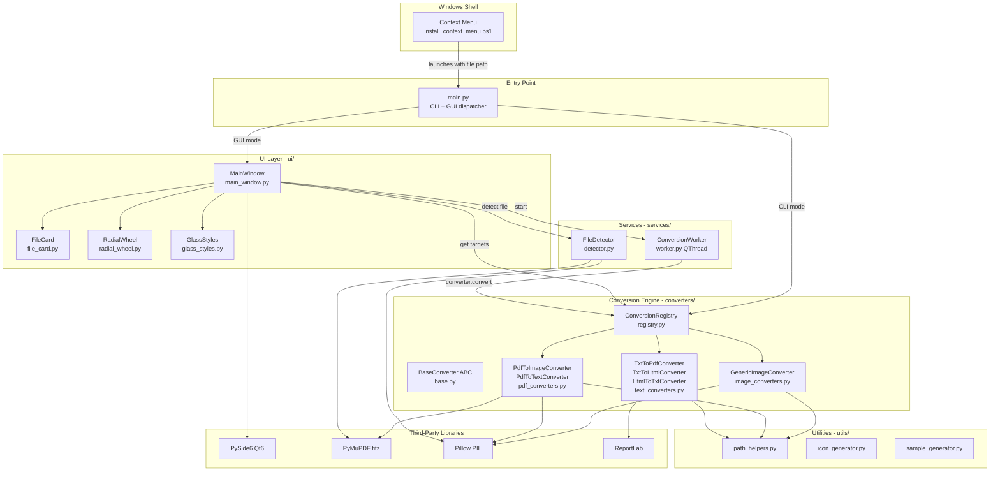
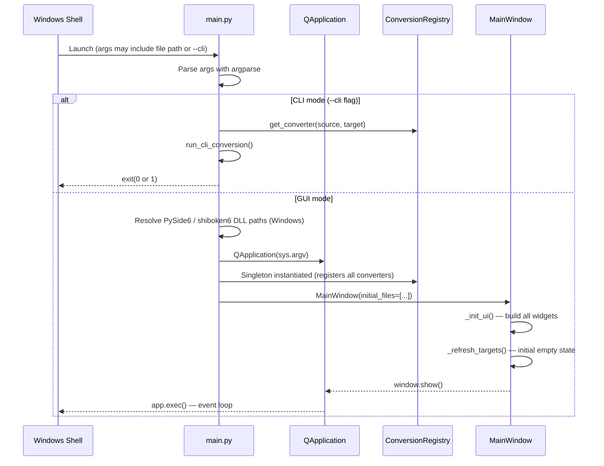
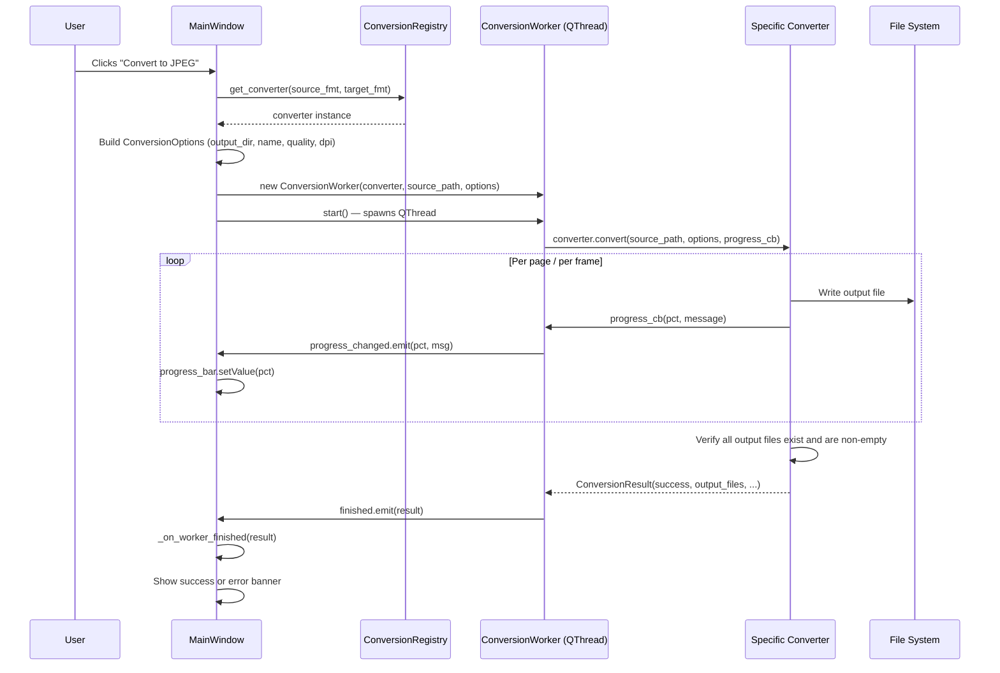

# architecture.md — System Architecture
## QuickConvert: Fast Offline File Converter for Windows

**Version:** 1.0 | **Date:** 2026-10-24

---

## 1. Architecture Overview

QuickConvert follows a clean layered architecture separating:

1. **Presentation Layer** — PySide6 Qt widgets (`ui/`)
2. **Service Layer** — File detection, background worker (`services/`)
3. **Conversion Engine** — Format-specific converters and central registry (`converters/`)
4. **Utilities** — Shared helpers for paths, filenames, icons, and test sample generation (`utils/`)
5. **Entry Point** — GUI + CLI dispatcher (`main.py`)
6. **Windows Integration** — PowerShell context-menu installer/uninstaller (`*.ps1`)

No component in a lower layer imports from a higher layer. The UI never directly calls conversion logic; it always goes through the registry and a background worker.

---

## 2. High-Level Component Diagram



---

## 3. Application Startup Flow



---

## 4. File Selection and Detection Flow

```mermaid
sequenceDiagram
    participant User
    participant FC as FileCard
    participant MW as MainWindow
    participant DET as FileDetector
    participant RW as RadialWheel
    participant REG as ConversionRegistry

    User->>FC: Drops file or clicks Browse
    FC->>MW: file_dropped.emit(path)
    MW->>DET: FileDetector.detect(path)
    DET->>DET: Read magic bytes (up to 4096 bytes)
    DET->>DET: Match MAGIC_SIGNATURES dict
    DET->>DET: Fallback: text / HTML detection
    DET->>DET: Format-specific validation (PDF page count, image dims, text encoding)
    DET-->>MW: FileInfo(detected_format, is_valid, size, page_count, dimensions, ...)
    MW->>FC: set_file(info) — update file card display
    MW->>REG: get_target_options_for_source(detected_format)
    REG-->>MW: List[TargetOption] (enabled/disabled per converter availability)
    MW->>RW: set_file_info(info, targets)
    RW->>RW: Auto-select first enabled target; repaint
    RW->>MW: target_selected.emit(fmt)
    MW->>MW: _update_convert_button()
```

---

## 5. Windows Explorer Context Menu Flow

```
User right-clicks file.png
  -> Windows Shell reads HKCU\Software\Classes\*\shell\QuickConvert\command
  -> Executes: "pythonw.exe" "main.py" "%1"
       (or QuickConvert.exe "%1" if packaged)
  -> main.py receives file path as positional arg in remaining_args
  -> GUI mode launches with initial_files=[file.png]
  -> MainWindow.load_file(file.png) called on startup
```

**Implementation:** `install_context_menu.ps1` writes to HKCU using `Microsoft.Win32.Registry` .NET API (no shell string injection). Supports both dev (pythonw.exe) and packaged (QuickConvert.exe) targets.

> **Important limitation:** On Windows 11, this appears in the legacy context menu (via "Show more options"). The primary context menu on Windows 11 requires a COM `IExplorerCommand` registration — not currently implemented.

---

## 6. Conversion Request and Execution Flow



---

## 7. Conversion Registry and Compatibility Detection

**File:** `converters/registry.py`

`ConversionRegistry` is a singleton instantiated at module import time. It:

1. Detects optional dependencies (LibreOffice via `shutil.which("soffice")` and common install paths)
2. Registers all converters with `(source_fmt, target_fmt)` tuple keys
3. Normalizes format strings (`jpg` → `jpeg`, case-insensitive)
4. Exposes `get_target_options_for_source(fmt)` which returns a `List[TargetOption]` with `is_enabled` and `disabled_reason` for every known format

The UI wheel **always** queries the registry — it never hardcodes which formats are available. If a converter is not registered, the format node is disabled with an explanation.

---

## 8. Background Workers and UI Thread Separation

**File:** `services/worker.py`

`ConversionWorker` extends `PySide6.QtCore.QThread`:

- `progress_changed = Signal(int, str)` — emitted from within the conversion loop
- `finished = Signal(object)` — emitted with a `ConversionResult` on completion or error
- Cancellation: sets `_is_cancelled = True`; the progress callback raises `InterruptedError` which is caught and reported cleanly
- The main UI thread **never** blocks — all conversion I/O runs on the worker thread

Signal/slot connections cross the thread boundary safely via Qt's queued connection mechanism.

---

## 9. File Validation and Output Management

### Validation (`services/detector.py`)

| Stage | What it checks |
|---|---|
| File existence | `path.exists()` |
| File type | `path.is_file()` |
| File size | `stat().st_size` (rejects 0-byte files) |
| Magic bytes | First 4096 bytes matched against `MAGIC_SIGNATURES` dict |
| WebP | RIFF + WEBP header pattern |
| Text/HTML | UTF-8 or latin-1 decode; HTML tag scan |
| PDF deep check | PyMuPDF `is_encrypted`, `len(doc)` page count |
| Image deep check | Pillow `img.verify()`, dimensions, mode, transparency, frame count |

### Output Management (`utils/path_helpers.py`)

- `sanitize_filename(name)` — strips invalid Windows chars; returns `"converted"` for empty/blank input
- `get_unique_output_path(dir, name, ext)` — increments `(1)`, `(2)` … until collision-free
- `get_multipage_output_paths(dir, name, ext, n)` — generates `_001`, `_002` … series; checks for collisions on whole series before committing

---

## 10. Error Propagation

```
FileDetector.detect()  ->  FileInfo(is_valid=False, validation_error="...")
                             -> UI: shows error in FileCard, disables convert button

Converter.convert()    ->  ConversionResult(success=False, error_message="...")
                             -> Worker emits finished(result)
                             -> MainWindow._on_worker_finished() shows error banner

ConversionWorker.run() ->  InterruptedError (cancel) or Exception
                             -> Caught; emits ConversionResult(success=False)
```

No exception is swallowed silently. Every error path produces a user-readable message.

---

## 11. Technology Stack

| Technology | Version | Reason |
|---|---|---|
| **Python** | 3.11+ | Primary language; excellent library ecosystem |
| **PySide6** | ≥6.6.0 | Official Qt6 binding; native Windows look; QThread for workers |
| **PyMuPDF (fitz)** | ≥1.23.0, <2.0.0 | Best-in-class PDF rendering and text extraction |
| **Pillow** | ≥10.0.0 | Industry-standard raster image I/O |
| **ReportLab** | ≥4.0.0 | Reliable PDF generation from text |
| **PyInstaller** | ≥6.3.0 | Single-folder Windows executable packaging |
| **pytest** | ≥7.4.0 | Automated test runner |
| **LibreOffice** | Optional | Office format conversions (DOCX) |

---

## 12. Folder Structure

```
QuickConvertMowa/
├── main.py                         # Entry point: CLI + GUI dispatcher, DLL path setup
├── requirements.txt                # Pinned dependencies
├── install_context_menu.ps1        # HKCU context menu registration (no admin)
├── uninstall_context_menu.ps1      # Context menu removal
│
├── converters/                     # Conversion engine
│   ├── __init__.py
│   ├── base.py                     # BaseConverter ABC, ConversionOptions, ConversionResult
│   ├── registry.py                 # ConversionRegistry singleton, TargetOption dataclass
│   ├── image_converters.py         # GenericImageConverter (Pillow)
│   ├── pdf_converters.py           # PdfToImageConverter, PdfToTextConverter (PyMuPDF)
│   └── text_converters.py          # TxtToPdfConverter, TxtToHtmlConverter, HtmlToTxtConverter
│
├── services/                       # Application services
│   ├── __init__.py
│   ├── detector.py                 # FileDetector: magic byte + deep validation
│   └── worker.py                   # ConversionWorker: QThread wrapper
│
├── ui/                             # PySide6 UI components
│   ├── __init__.py
│   ├── main_window.py              # QMainWindow: layout, state machine, event handlers
│   ├── radial_wheel.py             # RadialWheel: custom QPainter widget
│   ├── file_card.py                # FileCard: drag-drop zone + file info display
│   └── glass_styles.py             # MAIN_STYLESHEET, PALETTE, FORMAT_ACCENT_COLORS
│
├── utils/                          # Shared utilities
│   ├── __init__.py
│   ├── path_helpers.py             # sanitize_filename, get_unique_output_path, format_file_size
│   ├── icon_generator.py           # Programmatic app icon generation
│   └── sample_generator.py         # Test sample file generator
│
├── tests/                          # Automated test suite
│   ├── __init__.py
│   ├── test_converters.py          # All conversion pair tests (15 tests)
│   ├── test_detector.py            # FileDetector tests (10 tests)
│   ├── test_registry.py            # Registry and normalization tests (5 tests)
│   └── test_cli.py                 # CLI mode tests (4 tests)
│
├── assets/                         # Static resources (icons, etc.)
├── test_samples/                   # Dev-time generated test files
├── docs/                           # Project documentation (this folder)
└── .venv/                          # Python virtual environment
```

---

## 13. Component Interfaces and Data Flow

### Key Dataclasses

```python
# converters/base.py
@dataclass
class ConversionOptions:
    custom_output_name: Optional[str]
    output_dir: Optional[Path]
    jpeg_quality: int = 90
    dpi: int = 150
    multipage_extract_all: bool = True

@dataclass
class ConversionResult:
    success: bool
    source_file: Path
    output_files: List[Path]
    error_message: Optional[str]
    details: Optional[str]

# converters/registry.py
@dataclass
class TargetOption:
    target_format: str
    label: str
    is_enabled: bool
    disabled_reason: str
    output_extension: str
    is_multipage: bool
    converter: Optional[BaseConverter]

# services/detector.py
@dataclass
class FileInfo:
    path: Path
    detected_format: str
    declared_extension: str
    size_bytes: int
    is_valid: bool
    is_encrypted: bool
    validation_error: Optional[str]
    mime_type: str
    page_count: Optional[int]
    dimensions: Optional[tuple[int, int]]
    has_transparency: bool
```

---

## 14. Dependency Management

- All dependencies declared in `requirements.txt` with version constraints
- Virtual environment in `.venv/` (Python 3.11, Windows)
- PyInstaller bundles all dependencies into `dist/QuickConvert/`
- `main.py` contains Windows DLL path resolution for PySide6/shiboken6 to handle both dev and packaged environments

---

## 15. Packaging and Distribution

**Tool:** PyInstaller ≥6.3.0

```bash
pyinstaller --name QuickConvert \
            --windowed \
            --icon assets/icon.ico \
            --add-data "assets;assets" \
            main.py
```

Output: `dist/QuickConvert/QuickConvert.exe` (single-folder build)

The context menu installer detects the packaged exe at `dist\QuickConvert\QuickConvert.exe` and prefers it over the dev `pythonw.exe` path.

> **Status:** PyInstaller build command has not yet been executed and verified. See `task.md` Phase 6.

---

## 16. Testing Strategy

| Test File | Coverage |
|---|---|
| `test_converters.py` | 15 converter tests: all enabled pairs, multipage, overwrite, encrypted |
| `test_detector.py` | 10 detector tests: PDF, encrypted PDF, empty, corrupt, misleading ext, transparency, TIFF, GIF, text, HTML |
| `test_registry.py` | 5 tests: converter count, PDF/PNG targets, unknown source, normalization |
| `test_cli.py` | 4 tests: help output, successful CLI conversion, corrupt file failure, missing args |

**Result (2026-10-24):** 34/34 tests pass in 20.61s

Tests use `pytest` fixtures with `tmp_path_factory` for isolation. `sample_generator.py` generates fresh test files including edge cases (encrypted PDF, corrupt PDF, 0-byte file, misleading extension).

---

## 17. Security Boundaries and Privacy

- **No network I/O** — zero HTTP/socket calls anywhere in the application
- **HKCU only** — context menu writes to `HKCU\Software\Classes\*\shell\QuickConvert` (user scope, no admin)
- **No shell=True** — `subprocess.run` in Explorer launch uses argument list only
- **No file execution** — input files are opened for reading only (fitz, PIL, open())
- **Path validation** — `FileDetector.detect()` validates existence before any I/O
- **Output isolation** — output always written to a separate path; source is read-only

---

## 18. Architecture Decisions, Trade-offs, and Future Extensions

| Decision | Rationale | Trade-off |
|---|---|---|
| PySide6 over PyQt6 | Official Qt binding, LGPL license | Larger download than tkinter |
| PyMuPDF over pdf2image | Faster, more reliable, no Poppler dependency | Version pinning needed due to API changes |
| Pillow over OpenCV | Smaller, simpler image I/O | No video support |
| ReportLab for TXT→PDF | Precise control; no headless browser needed | No HTML rendering to PDF |
| QThread worker | Prevents UI freeze; Qt-native cancellation | Slightly more boilerplate than threading.Thread |
| HKCU registry context menu | No admin required; easy to uninstall | Legacy menu on Windows 11 (behind "Show more options") |
| Registry singleton | One source of truth for all components | Module-level initialization (acceptable for desktop app) |
| Magic byte detection | Handles misleading extensions | Requires file read on every load |

### Future Extension Points

- **LibreOffice bridge** — `registry.py` already detects soffice; converters just need registering
- **Modern Windows 11 context menu** — COM `IExplorerCommand` via Python ctypes or a small C# shim
- **Batch mode** — `MainWindow` would need a file list widget; `ConversionWorker` wraps multiple calls
- **OCR** — Additional converter class using Tesseract; registered only if `pytesseract` is available
- **Plugin system** — Converters could be discovered from a plugins directory at startup
